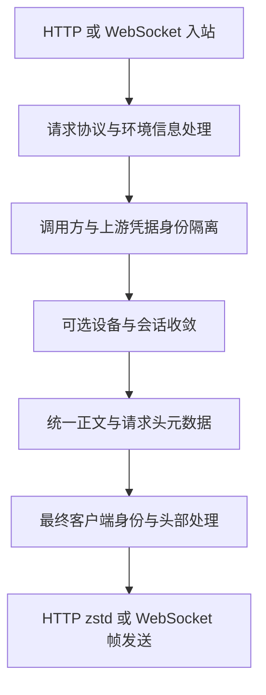

# Codex 客户端指纹模拟实现

梳理日期：2026-10-21。

当前仓库通过客户端身份统一、设备与会话标识处理、元数据序列化、请求协议转换和传输压缩，对齐 Codex 客户端可见的出站特征。其中，JSON 字段顺序、UUID 版本与时间戳、HTTP 与 WebSocket 头部差异，都有专门处理。

这些实现主要属于应用协议和部分传输格式的对齐。核心 Codex 发送链仍使用 Go HTTP transport 和 `coder/websocket`，没有接入仓库用于 Claude 的 uTLS 指纹功能，因此不能据此认定 TLS ClientHello、HTTP/2 SETTINGS 或 HTTP 头部线序与官方 Rust 客户端完全一致。

## 适用范围与转发流程

本文主要覆盖 OpenAI OAuth 与 OpenAI SetupToken 账号发往 ChatGPT Codex 后端的推理链。公共 API Key、第三方兼容接口、legacy compact 和插件接管路径各有条件分支，不能直接套用全部结论。



这是主要处理关系，具体顺序随 HTTP、透传和 WS 入口略有不同。重要约束是：正文和头部必须使用一致的身份结果，最终头部清理必须放在元数据补齐之后，避免刚删除的旧头再次被补回。

主要调用位置：

- [普通 HTTP 转发与请求构造](../internal/service/openai_gateway_forward.go)。
- [HTTP 透传](../internal/service/openai_gateway_passthrough.go)。
- [WS 握手与帧构造](../internal/service/openai_ws_forwarder_payload.go)。
- [WS v2 透传适配](../internal/service/openai_ws_v2_passthrough_adapter.go)。

## 客户端身份与版本

### 身份三元组

`resolveCodexOutboundIdentity` 统一生成 `User-Agent`、`originator` 和 `version`，使客户端名称和版本相互匹配。当前内置兜底值为：

```text
User-Agent: codex-tui/0.159.3 (Windows 10.0.22621.1848; x86_64) dumb
originator: codex-tui
version: 0.159.3
```

管理员配置的 UA 可以贡献受支持的客户端名称、操作系统、架构和终端信息；版本段会按当前生效版本重建。无法配对为受支持身份的 UA 回退到规范身份。

版本优先级为：管理员手工设置、已同步版本、内置 `0.159.3`。自动同步服务按六小时周期查询 `openai/codex` 的稳定发布，是否执行受自动同步设置控制。关闭自动同步不会自动清除已有同步值，因此部署实际使用的版本不能只看编译期常量。

普通推理请求默认开启身份强制统一。配置 `gateway.disable_codex_identity_enforcement=true` 后，退回按最终 UA 配对 originator、校正低版本的处理方式，同时停止最终的非官方头部清理。该开关与账号级设备收敛模式相互独立。

实现：[身份解析与强制统一](../internal/service/openai_codex_identity.go#L133)、[内置 UA 和版本](../internal/service/openai_gateway_service.go#L36)、[版本解析优先级](../internal/service/setting_gateway_runtime.go#L340)、[自动同步](../internal/service/openai_codex_version_sync_service.go#L12)。

### 凭据面与模型清单

发往凭据面的请求复用规范 UA 与 originator，但 `ApplyCodexCanonicalAuthIdentity` 不补 `version`。推理面的身份规则不能无条件扩展到认证端点。

模型清单请求也是独立链路。其 UA 和 originator 使用规范身份，但 `Version` 优先采用合法且不低于代码门槛的客户端 `client_version`；查询参数自身保留客户端值。因此模型清单请求的版本处理与普通推理三元组并不完全相同。

实现：[凭据面身份](../internal/service/openai_codex_identity.go#L86)、[模型清单身份与版本](../internal/service/openai_codex_models_service.go#L1791)。

## 最终出站请求头

`projectCodexOutboundHeaders` 在前面的身份隔离、收敛和元数据处理完成后，删除代码列出的非官方头，并在已有 `session-id` 时补齐缺失的 `thread-id`。

| 头部 | 普通 HTTP Responses | WebSocket 握手 |
| --- | --- | --- |
| `session-id`、`thread-id` | 保留，缺失的 thread 可由 session 补齐 | 同左 |
| `session_id`、`conversation_id` | 删除 | 删除 |
| `x-codex-installation-id` | 删除；安装信息留在正文元数据中 | 同左 |
| `accept-language` | 删除 | 删除 |
| `OpenAI-Beta` | 删除 | 保留 WS 协议值 |
| `x-client-request-id` | 保留，可与 thread 身份对齐 | 保留 |

这是显式字段清单的投影，并不控制底层 HTTP 库最终如何排列头部。

Codex WS 使用 `responses_websockets=2026-02-06`，并按条件保留 window、parent-thread、subagent、memgen 和 timing metrics 等头。完整工具清单留在帧正文，避免进入 Upgrade 请求头。

普通 HTTP 与透传入口采用请求头白名单，客户端 Cookie 不会因此原样进入上游。普通 Responses WS 也不会因为客户端携带 `x-oai-attestation` 就转发该证明。

仍走 legacy compact 的请求以及 messages 桥接有独立处理，不能套用常规 Responses 的最终清理规则。

实现：[HTTP 与 WS 删除清单及投影](../internal/service/openai_codex_identity.go#L252)、[HTTP 最终处理](../internal/service/openai_gateway_forward.go#L1605)、[WS 条件头和 Beta](../internal/service/openai_ws_forwarder_payload.go#L106)、[请求头白名单](../internal/service/openai_gateway_service.go#L72)。

## 身份隔离与指纹收敛

### 调用方与上游凭据隔离

账号身份隔离结合下游 API Key 和上游凭据命名空间派生标识，避免一次切号把同一套客户端身份直接用于另一上游账号。命名空间优先使用 ChatGPT account ID 和可用的 user ID，再使用持久化指纹种子；SetupToken 还可使用 token 摘要。凭据影子账号先解析真实凭据来源。

隔离范围包括 installation、session、thread、turn、window、相关请求头和 `prompt_cache_key`。如果原始 cache key 与 session 相同，处理时维护这层对应关系。

实现：[凭据命名空间](../internal/service/openai_codex_account_identity.go#L49)、[正文身份与 cache key](../internal/service/openai_codex_account_identity.go#L186)。

### 账号级收敛模式

`accounts.extra.codex_fingerprint_mode` 控制额外收敛，缺省为 `off`。`off` 只关闭这一层，账号隔离、规范客户端身份和缺失元数据补齐仍然存在。

| 模式 | 当前实现 |
| --- | --- |
| `off` | 不启用额外设备或 session 收敛。 |
| `device` | 将 installation 收敛为账号固定值，其余会话与回合关系保留。 |
| `session` | 收敛 installation 和 session，保留独立 thread、turn 及压缩窗口序号。 |
| `full` | 当前与 `session` 共用核心分支，不代表所有客户端共用一个 thread 或 turn。 |

非 `off` 模式需要系统管理的有效随机种子。安装标识优先采用账号配置的真实 device ID，否则从种子确定性派生。请求正文和请求头共享同一份预计算结果；重试切号时覆盖暂存结果，避免上一账号的收敛状态残留。

实现：[默认模式](../internal/service/openai_codex_fingerprint.go#L190)、[模式分支](../internal/service/openai_codex_fingerprint.go#L323)、[头部与正文共用结果](../internal/service/openai_codex_fingerprint.go#L402)。

### UUID 与时间关系

installation 使用 UUIDv4 形状，session、thread 和 turn 使用 UUIDv7 形状。改写已有 v7 时保留其时间戳位；非 v7 原值或需要稳定派生的标识使用代码中的过去时间锚点。缺失 turn 的兜底生成使用当前时间。

window 按 `thread:压缩窗口序号` 处理，作用域改写保留序号。已有 turn 和开始时间不会仅因一次新的 HTTP 请求就被无条件重建。完全缺少会话信号时，兜底 session 会尝试使用响应链或带用户锚点的内容信号区分对话。

这些规则维护格式和关系；确定性派生的时间戳并不代表设备或会话真实创建于该时刻。

实现：[UUID 派生与时间锚点](../internal/service/openai_codex_fingerprint.go#L208)、[作用域改写保留 v7 时间](../internal/service/openai_codex_account_identity.go#L93)、[缺失字段补齐与兜底会话](../internal/service/openai_codex_turn_metadata.go#L448)。

## 元数据与 JSON 序列化

### 元数据关系

`normalizeCodexRequestMetadata` 和相关函数协调三个表示：正文 `client_metadata` 的平铺字段、其中内嵌的 `x-codex-turn-metadata` JSON 字符串，以及传输请求头。

缺失时补齐 installation、session、thread、turn、window、window number、context window、request kind 和 turn 开始时间。已有元数据优先，`json.Number` 用于避免大整数在改写过程中经浮点数损失精度。

正文保留完整 `tool_namespaces_info`，头部投影删除这一字段。因此两份元数据共享相关身份值，但不要求整段字节相同。legacy compact 的正文类型没有普通 `client_metadata`，相应分支不会给它增加该字段。

实现：[元数据归一化](../internal/service/openai_codex_turn_metadata.go#L277)、[头部投影](../internal/service/openai_codex_turn_metadata.go#L395)、[缺失字段补齐](../internal/service/openai_codex_turn_metadata.go#L412)。

### 字段顺序与转义

turn metadata 使用专门编码器复刻代码所引用的 Rust serde 对象形状：

- 已知字段按 struct 声明顺序输出，未知字段按字典序追加。
- workspace、工具 namespace、function 和 compaction 子对象也有指定顺序。
- 非 ASCII 字符使用 JSON 转义；`&`、`<`、`>` 不做 HTML 转义。
- 数字重写保持整数精度。

普通请求正文重新编码后，`restoreOpenAIUpstreamJSONTopLevelOrder` 恢复已有顶层字段的原始相对顺序；新增的已知字段按 Codex 字段清单追加，其他新增字段沿编码结果顺序追加。它不把所有输入强制重排为同一种顺序，也不递归恢复普通正文全部嵌套对象的原始顺序。

实现：[turn metadata 顺序与编码器](../internal/service/openai_codex_turn_metadata.go#L24)、[普通正文关闭 HTML 转义](../internal/service/openai_gateway_upstream_errors.go#L477)、[顶层顺序恢复](../internal/service/openai_gateway_upstream_errors.go#L491)。

## 请求协议与跨请求状态

### Responses 与 Responses Lite

常规 OAuth 请求会强制 `store=false`、`stream=true`，删除 ChatGPT Codex 后端不支持的部分采样和输出限制参数，并在携带 reasoning 时按需补齐 `include: ["reasoning.encrypted_content"]`。

Responses Lite 将工具声明和非空 instructions 转为输入前缀，维护已有历史工具声明和结果，关闭并行工具调用，并只在图片内容项上移除 `detail`。公共 API Key 路径不直接套用这套私有转换。

实现：[OAuth 请求转换](../internal/service/openai_codex_transform.go#L179)、[Lite 转换](../internal/service/openai_responses_lite_tools.go#L24)。

### 压缩上下文与能力声明

OpenAI 账号的 legacy compact 请求在入口提升为 native Responses compaction v2：使用普通 Responses 路径，设置 `stream=true`、`store=false`，并将 `compaction_trigger` 放在 input 末尾。非 OpenAI 兼容供应商保留各自 legacy 路径。

`x-codex-beta-features` 按会话能力处理。普通 OAuth 请求缺少非空声明时补 `remote_compaction_v2`；已有非空声明保留，识别出的 native v2 压缩回合则确保包含该能力。routing hint 使用最终模型和生效的服务档位生成。

实现：[compact 提升](../internal/service/openai_compact_body_signal.go#L70)、[会话能力声明](../internal/service/openai_compact_body_signal.go#L162)、[routing hint](../internal/service/openai_routing_hint.go#L16)。

### 上游 turn state

`x-codex-turn-state` 使用上游签发的不透明值。代码在真正提交响应给下游时记录其来源，并按具体 token 跟踪，而非只保存会话最后一个值。后续请求携带已知来自另一上游账号的 token 时，出站前将其剥离；同账号或无来源记录的值保留。

实现：[响应提交与来源记录](../internal/service/openai_codex_turn_state.go#L53)、[出站来源检查](../internal/service/openai_codex_turn_state.go#L129)。

## 环境信息与传输格式

### 时区与位置

账号 `openai_request_timezone` 决定请求环境时区，默认 `Asia/Singapore`。处理针对 OpenAI 账号的 user 输入中符合结构的 `environment_context`，替换已有 timezone，缺失时补 timezone 和按该时区生成的 current date。

已有 `current_date` 当前会保留，不会统一重算；这比 `DEV_GUIDE.md` 中“日期按该时区重新生成”的描述更窄。没有符合结构的环境块时，也不会凭空创建完整环境上下文。

web search 已有 `user_location.timezone` 时会同步替换。当前完整位置映射只登记新加坡，并替换已有的 country、region、city 字符串字段；其他时区不推测国家城市，也不自动补全所有位置字段。

实现：[默认时区与账号设置](../internal/service/openai_request_timezone.go#L14)、[环境字段处理](../internal/service/openai_request_locale.go#L44)、[web search 位置处理](../internal/service/openai_request_locale.go#L246)。

### HTTP 与 WebSocket 发送

核心 HTTP 发送链会对符合以下条件的请求进行 zstd 压缩：HTTPS、目标 `chatgpt.com`、路径 `/backend-api/codex/responses`、POST、JSON 正文且可重放，原请求没有其他有效 Content-Encoding。

压缩发生在每次发送使用的请求副本上，并同步更新 `ContentLength` 和 `GetBody`，清除旧长度与 Transfer-Encoding。公共 API、其他域名、legacy compact 和 WS 帧不套用这层 zstd；已提升为普通 Responses 的 compact 则按实际出站端点处理。

OpenAI HTTP transport 关闭 Go 自动添加的 `Accept-Encoding: gzip`，响应解压由仓库处理。HTTP/2 可按配置启用，并有代理兼容回退；这属于传输策略，不代表复刻了官方 HTTP/2 指纹。

WS 使用 `coder/websocket`，启用其压缩协商选项。入站协议与上游协议也可以不同：HTTP 客户端可按账号配置使用 WS 上游，网关再转换成 SSE 或 JSON 返回。

实现：[zstd 请求压缩](../internal/repository/http_upstream.go#L326)、[HTTP transport](../internal/repository/http_upstream.go#L1454)、[WS dialer](../internal/service/openai_ws_client.go#L115)、[HTTP 到 WS 转发](../internal/service/openai_ws_http_bridge.go)。

## 实现边界与验证状态

### 核心传输与插件

仓库 uTLS 功能的账号开关只适用于 Anthropic OAuth 和 SetupToken。Codex 核心发送经 `httpUpstream.Do`，WS 使用 Go WebSocket 客户端；核心代码没有证明与官方 Rust 客户端底层网络指纹逐字节一致。

启用并命中 OpenAI OAuth 出站插件时，请求可由插件接管；此时最终传输行为取决于插件。核心 repository 中的 zstd 和 transport 规则不能无条件外推到该路径。

实现：[TLS 指纹适用范围](../internal/service/account.go#L2459)、[核心或插件发送分支](../internal/service/openai_plugin_transport.go#L61)、[插件命中规则](../internal/service/plugin_manager.go#L947)。

### 降智检测与历史打票功能

当前降智检测通过本进程网关入口进入中间件、指定账号调度和正式转发链，复用同一套客户端指纹处理。v1.2.0 已移除打票收割和票据注入；旧文件名、表名或注释中出现 ticket、harvest，不代表完整打票链仍在运行。

`codex_fingerprint.go` 实现的是 ModelTrace 模型识别，与 `openai_codex_fingerprint.go` 中的客户端设备收敛是两个概念。模型识别结果也不等于客户端指纹与官方完全一致的证明。

实现：[网关诊断入口](../internal/service/codex_diagnostic_gateway.go#L19)、[ModelTrace 实现](../internal/service/codex_fingerprint.go#L16)、[移除打票记录](../../changelog/1.2.0/CHANGELOG.md#L5)。

### 验证范围

本次核对基于当前工作区源码和已有测试阅读，未读取运行中的设置、账号配置或已安装插件，也未与真实上游抓包比较。环境没有 Go，未执行测试。本文记录代码行为，不将仓库注释中的上游风控推断或 README 的“不降智、不封号”表述作为已验证效果。

已有相关测试包括：

| 验证意图 | 测试文件 |
| --- | --- |
| 身份三元组一致，覆盖版本来源与开关 | [身份测试](../internal/service/openai_codex_identity_test.go) |
| 收敛保持正文和头部一致，默认关闭且切号不残留 | [收敛测试](../internal/service/openai_codex_fingerprint_test.go) |
| UUID 版本与时间关系不漂移 | [身份时间测试](../internal/service/openai_codex_identity_drift_test.go) |
| 元数据字段顺序、转义、嵌套结构与往返字节 | [元数据测试](../internal/service/openai_codex_turn_metadata_test.go)、[往返测试](../internal/service/openai_codex_turn_metadata_roundtrip_test.go) |
| 请求正文重写后保持顶层顺序 | [正文顺序测试](../internal/service/openai_codex_body_key_order_test.go) |
| WS 实际连接保留条件头、正文工具清单并剥离不适用头 | [WS socket 测试](../internal/service/openai_codex_ws_socket_test.go) |
| 压缩后的正文、长度与重放一致 | [请求压缩测试](../internal/repository/openai_request_compression_test.go) |
